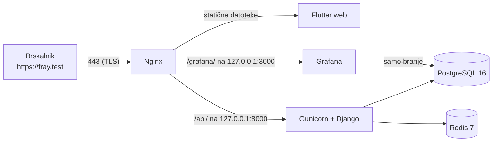

# Fray – samodejna postavitev z Vagrantom in cloud-init

Različica z Vagrantom z enim ukazom (`vagrant up`) ustvari virtualni računalnik z Ubuntu 24.04 in na njem postavi aplikacijo **Fray** s celotnim produkcijskim okoljem: Nginx z HTTPS, aplikacijski strežnik, podatkovna baza, predpomnilnik, nadzorna plošča, varnostne kopije in utrjen sistem. Spodnji razdelki opisujejo različico z Vagrantom.

**Različica s cloud-init** na prenosniku s QEMU/KVM zažene Ubuntu iz uradne slike. Ob prvem zagonu nastavi Fray, PostgreSQL, Redis in Nginx ter beleženje in nadzor z Alloy, Loki, Prometheusom in Grafano. Za javni HTTPS uporabi Let’s Encrypt. [Navodila za zagon in preverjanje](cloud-init/README.md#reproduce-the-deployment) · [Težave pri postavitvi s cloud-init](cloud-init/README.md#problems-we-encountered) · [Posnetek dnevnikov v Grafani](docs/screenshots/cloud-init-grafana-logs.png)

## O projektu

**Fray** je aplikacija za zasebno beleženje časa (splet, iOS, Android). Spletni odjemalec je napisan v Flutterju, strežnik v Djangu. Uporabniki se prijavijo z geslom in dvostopenjskim preverjanjem (TOTP). Aplikacija: <https://github.com/ELITE-Salty/fray>.

Okolje je zapisano kot koda: `Vagrantfile` in ločene, ponovljive skripte, ki prek `apt` namestijo in varno nastavijo vse komponente. Vsak korak je v zgodovini repozitorija en commit.

## Arhitektura



Navzven so odprta samo vrata 22, 80 (preusmeritev) in 443. Gunicorn, PostgreSQL, Redis in Grafana poslušajo samo na `127.0.0.1`. Virtualni računalnik je na naslovu `192.168.56.10`, na gostitelju pa ga razrešimo kot `fray.test`.

## Komponente

| Komponenta | Vir | Vrata | Vloga |
|------------|-----|-------|-------|
| **Nginx** | apt | 80, 443 | Obratni posrednik, HTTPS, statične datoteke, omejevanje zahtev |
| **Fray API** (Django 5.2, Gunicorn) | apt (Python 3.12) + pip v `venv` | 127.0.0.1:8000 | Aplikacijska logika in prijava |
| **PostgreSQL 16** | apt | 127.0.0.1:5432 | Podatkovna baza |
| **Redis 7** | apt | 127.0.0.1:6379 | Predpomnilnik in omejevanje zahtev, zaščiten z geslom |
| **Grafana** | uradni Grafana apt repozitorij | 127.0.0.1:3000 | Nadzorna plošča |
| **UFW, fail2ban, OpenSSL** | apt | – | Požarni zid, zaščita pred ugibanjem gesel, lasten overitelj |

## Zagon

**Zahteve:** Windows z VirtualBoxom, Vagrantom (iz PowerShella) in WSL2 (Ubuntu) z `git`, `rsync` in Flutterjem za gradnjo spletnega odjemalca.

```bash
# 1. WSL: zgradi arhiv izdaje (backend + Flutter web, brez skrivnosti)
git clone https://github.com/ELITE-Salty/fray.git ~/src/fray
./scripts/build-release.sh ~/src/fray
```

```powershell
# 2. Nastavitve: v vagrant\.env mora biti FRAY_HOSTNAME=fray.test
Copy-Item vagrant\.env.example vagrant\.env

# 3. V C:\Windows\System32\drivers\etc\hosts (kot skrbnik) dodaj vrstico:
#    192.168.56.10 fray.test

# 4. Zagon
cd vagrant
vagrant up

# 5. PowerShell kot skrbnik, iz korena repozitorija: zaupaj lastnemu overitelju
powershell -ExecutionPolicy Bypass -File scripts\trust-ca.ps1
```

Skripta `trust-ca.ps1` prebere samo **javni** certifikat overitelja iz VM in ga uvozi v Windows. Zasebni ključ VM ne zapusti. Po uvozu znova zaženi brskalnik (Firefox ima lastno shrambo: uvozi `artifacts\fray-ca.cer` ali nastavi `security.enterprise_roots.enabled`). Vsak nov VM ima **novega** overitelja, zato je korak treba ponoviti.

Prvi račun se ustvari v VM (`vagrant ssh`), saj se geslo ne zapiše v nobeno skripto:

```bash
sudo systemd-run --wait --collect --pty \
  -p User=fray -p Group=fray -p EnvironmentFile=/etc/fray/fray.env \
  -p WorkingDirectory=/opt/fray/current/backend \
  /opt/fray/venv/bin/python manage.py create_fray_user ime@domena.si --name Ime
```

Struktura repozitorija:

```
├── scripts/            build-release.sh, trust-ca.ps1
├── artifacts/          arhiv izdaje (ni v gitu)
├── screenshots/
└── vagrant/
    ├── Vagrantfile, .env.example
    └── provision/      lib.sh, 00-base, 10-postgres, 20-redis, 30-app,
                        40-tls, 50-nginx, 60-monitoring, 70-backup (.sh)
```

`Vagrantfile` naloži skripte in arhiv v VM ter vsako skripto požene kot **ločen poimenovan ponudnik** (npr. `vagrant provision --provision-with 30-app`). Skripte so ponovljive (`set -euo pipefail`): ob ponovnem zagonu ne prepišejo skrivnosti in ne ustvarijo ničesar dvakrat.

## Dostop in skrivnosti

| Storitev | Naslov |
|----------|--------|
| Fray | <https://fray.test> (prijava z geslom + TOTP) |
| Zdravstveni pregled | <https://fray.test/api/health> |
| Grafana | <https://fray.test/grafana/> (uporabnik `admin`) |

Geslo za Grafano: `vagrant ssh -c "sudo grep ADMIN_PASSWORD /etc/grafana/grafana.env"`.

Vse skrivnosti se ob prvi namestitvi ustvarijo naključno in so v datotekah z omejenimi pravicami: `/etc/fray/fray.env` (ključ Djanga, ključ MFA, gesli baze in Redisa; `root:fray` 0640), `/etc/grafana/grafana.env` (0600), `/etc/fray-ca/` (ključ overitelja; mapa 0700) in `/var/backups/fray/` (0700). V repozitoriju ni nobene skrivnosti.

## Avtentikacija in varnost

**Avtentikacija in avtorizacija (po plasteh)**

- **Fray:** geslo + TOTP (`django-otp`); ključ za šifriranje MFA je ločen od ključa Djanga.
- **Grafana:** obvezna prijava, brez anonimnega dostopa in registracije; do baze dostopa z uporabnikom `grafana_ro` (vloga `pg_monitor`, samo branje, vsebine tabel ne vidi).
- **PostgreSQL:** uporabnik `fray` brez `SUPERUSER`/`CREATEDB`/`CREATEROLE`, ostali nimajo pravice povezave (`REVOKE ... FROM PUBLIC`), prijava `scram-sha-256`.
- **Redis:** `requirepass`, samo localhost. **SSH:** samo ključ, brez prijave kot `root`.

**Omrežje in sistem:** UFW dovoli samo 22, 80 in 443; fail2ban ščiti SSH in Nginx; samodejne varnostne posodobitve; trajni dnevniki journald. Aplikacija teče kot sistemski uporabnik `fray` brez lupine, koda izdaje je last `root` (samo za branje). Storitev `fray-api` je utrjena v systemd (`NoNewPrivileges`, `ProtectSystem=strict`, `PrivateTmp`, `SystemCallFilter` ...), kar izmerimo z `systemd-analyze security`.

**HTTPS:** strežnik je na zasebnem naslovu, zato javni overitelj ni uporaben. Skripta `40-tls.sh` ustvari **lasten overitelj z omejitvami imen** (lahko potrdi samo `fray.test` in `192.168.56.10`, zato z njim ni mogoče ponarediti drugih strani) in izda strežniški certifikat (EC P-256, 365 dni). Časovnik `fray-cert.timer` ga vsak dan preveri in 30 dni pred iztekom samodejno obnovi. Zasebni ključ overitelja je dosegljiv samo uporabniku `root`.

**Nginx:** TLS 1.2/1.3, preusmeritev HTTP na HTTPS, glave `X-Content-Type-Options`, `X-Frame-Options`, `Referrer-Policy`, `Permissions-Policy`, skrita različica, omejevanje zahtev na `/api/`, privzeti strežnik zavrne neznana imena (`444`), končna točka `/metrics` je od zunaj skrita (404).

## Spremljanje in dnevniki

Spremljanje poteka prek **Grafane**. Vir podatkov (PostgreSQL) in nadzorna plošča *Fray – PostgreSQL overview* sta nastavljena z datotekami, zato ročno nastavljanje ni potrebno. Plošča prikazuje velikost baze, aktivne povezave, razmerje zadetkov predpomnilnika, čas delovanja, število potrditev in preklicev transakcij, največje tabele in seje po stanju.

Dnevniki: journald je trajen (največ 300 MB, en mesec); Gunicorn piše dostopne dnevnike in napake v journal (`journalctl -u fray-api`); Nginx v `/var/log/nginx/` z `logrotate`; PostgreSQL beleži povezave in počasne poizvedbe (nad 500 ms).

## Varnostne kopije

Časovnik `fray-backup.timer` vsak dan ob 03:00 naredi `pg_dump` v `/var/backups/fray`. Kopija se preveri s `pg_restore --list`, šele nato se preimenuje. Skupaj z njo se shrani tudi datoteka okolja (v njej je ključ MFA, brez katerega obnova uporabnikov ni mogoča). Hrani se 7 dni. Skripta `fray-restore-check` zadnjo kopijo **obnovi v začasno bazo** in preveri tabele in migracije; zažene se ob vsaki namestitvi, zato delovanje kopij ni samo predpostavka.

## Hitrost in ponovljivost

```powershell
vagrant destroy -f
Measure-Command { vagrant up } | Select-Object TotalMinutes
```

| Meritev | Čas |
|---------|-----|
| Prvi `vagrant up` (škatla že prenesena) | **3 min 25s** |
| Ponovni `vagrant provision` | **0 min 40s** |

Namestitev pospešujejo povezani klon diska in vnaprej zgrajen arhiv izdaje (Flutter v VM ni potreben). **Ponovljivost:** kontrolni vsoti `sudo md5sum /etc/fray/fray.env /etc/grafana/grafana.env` pred ponovnim `vagrant provision` in po njem morata biti enaki, izpis pa ne sme vsebovati `Creating local CA` ali `Issuing server certificate`.

## Preverjanje delovanja

Pričakovan rezultat je v komentarju.

```powershell
curl.exe --ssl-no-revoke https://fray.test/api/health      # {"status":"ok"}
curl.exe -I http://fray.test                                # 301 na HTTPS
curl.exe --ssl-no-revoke -i https://fray.test/metrics       # 404
Test-NetConnection 192.168.56.10 -Port 5432                 # False (tudi 6379, 3000)
vagrant reload                                              # vse storitve se zaženejo same
```

```bash
systemctl is-active postgresql redis-server fray-api nginx grafana-server fail2ban   # 6x active
sudo ufw status verbose                      # samo 22, 80, 443
sudo sshd -T | grep -E 'passwordauthentication|permitrootlogin'   # oboje no
sudo openssl verify -CAfile /etc/fray-ca/ca.crt /etc/ssl/fray/server.crt   # OK
redis-cli ping                               # NOAUTH Authentication required
sudo /usr/local/sbin/fray-restore-check      # Restore check OK
sudo systemctl kill -s KILL fray-api; sleep 5; systemctl is-active fray-api   # active
```

Obnova certifikata: `sudo rm /etc/ssl/fray/server.crt && sudo systemctl start fray-cert.service` in nato ponovni klic `/api/health`. V brskalniku: `https://fray.test` se odpre z zaklenjeno ključavnico, prijava s TOTP uspe, vnos časa ostane po osvežitvi in nadzorna plošča v Grafani prikaže vseh osem plošč.

## Dodatne funkcionalnosti

- Lasten overitelj z omejitvami imen, samodejna obnova certifikata in skripta za uvoz v Windows.
- Sandboxing storitve v systemd z oceno `systemd-analyze security`.
- Neodvisni naključni ključi za Django in MFA, ki se ob ponovni namestitvi ne spremenijo.
- Grafana povsem iz datotek, z bralnim uporabnikom baze z najmanjšimi pravicami.
- Varnostne kopije s preverbo in samodejnim preizkusom obnove, vključno s ključem MFA.
- fail2ban tudi za Nginx, omejevanje zahtev, privzeti strežnik za neznana imena.
- Preverjanje kontrolne vsote arhiva; različice izdaj v `/opt/fray/releases/` s povezavo `current` (preprosta nadgradnja in vrnitev).
- Dnevno čiščenje potečenih sej (`fray-cleanup.timer`).

## Posnetki zaslona


## Odpravljanje težav

### Cloud-init na prenosniku

- **Telefon je na mobilnem omrežju dosegel testno datoteko prek HTTP, povezava HTTPS pa je potekla.** S tem smo preverili pot prek vrat 80. Nginx je na prenosniku že vrnil zdrav odziv z veljavnim certifikatom. Za javni HTTPS smo potrebovali še ločeno pravilo na usmerjevalniku: zunanja vrata TCP 443 → vrata 18443 na prenosniku. Javno pot smo potrdili z odzivom HTTP 200 na strani za prijavo v Grafano.
- **Registracija je vrnila HTTP 503.** Zahtevo smo našli v Lokiju. V VM je bila registracija izključena, manjkale so tudi nastavitve SMTP. Ko smo jih dodali in ponovno zagnali storitev `fray`, je naslednja registracija vrnila HTTP 201. Pri preverjanju dostave smo posebej preverili še naslov pošiljatelja.
- **Novo geslo iz datoteke `.env` ni veljalo za obstoječi račun Grafane.** Grafana začetno geslo uporabi ob prvem zagonu. Posodobili smo geslo računa `admin` v Grafani, uskladili nastavitev v VM in preverili novo prijavo prek javnega naslova HTTPS.

[Podrobnejši potek diagnostike in preverjanja](cloud-init/README.md#problems-we-encountered)

### Vagrant

| Težava | Rešitev |
|--------|---------|
| `Timed out while waiting for the machine to boot` | Počasen zagon (Hyper-V/WSL2). V `Vagrantfile` je `config.vm.boot_timeout = 600`; pomaga tudi `vagrant halt -f` in ponovni `vagrant up`. |
| `timeout during server version negotiating` | `vagrant reload --no-provision` |
| `\r: command not found` | Windowsovi konci vrstic. `.gitattributes` vsili LF; obstoječe popravi z `sed -i 's/\r$//' vagrant/provision/*.sh`. |
| `Invalid argument ... fray-latest.tar.gz` | Simbolna povezava iz WSL v `artifacts`. Izbriši jo in arhiv zgradi znova (skripta zdaj ustvari prave kopije). |
| Opozorilo o certifikatu | Poženi `scripts\trust-ca.ps1` kot skrbnik in znova zaženi brskalnik. |
| `400 Bad Request` | `FRAY_HOSTNAME` mora biti natančno `fray.test`; nato `vagrant provision`. |
| `502 Bad Gateway` | `journalctl -u fray-api -n 50` |

## Omejitve in čiščenje

- Certifikat je zaupanja vreden samo tam, kjer je overitelj uvožen (strežnik je na zasebnem naslovu, javni overitelj ni uporaben).
- Varnostne kopije so na istem VM kot baza; v pravem okolju bi jih bilo treba kopirati drugam.
- Spremljanje prikazuje trenutno stanje baze; zgodovine meritev (procesor, pomnilnik) ni, ker zbiralnik metrik ni uporabljen.
- Samostojna registracija zahteva nastavitve e-pošte (`FRAY_EMAIL_*`); brez njih se računi ustvarjajo z ukazom iz razdelka 4.

```powershell
cd vagrant
vagrant destroy -f                                       # izbriše VM in vse podatke
certutil -delstore Root "Fray Local CA (fray.test)"      # kot skrbnik: odstrani overitelja
```

Po čiščenju odstrani še vrstico `192.168.56.10 fray.test` iz datoteke `hosts`.