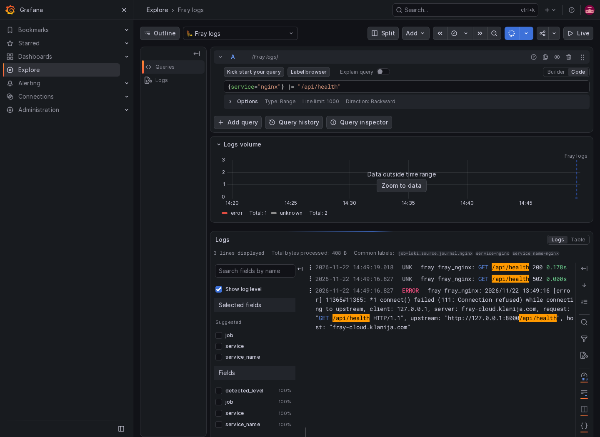

# Run Fray on a Wi-Fi laptop with Let's Encrypt

The laptop hosts an Ubuntu 24.04 VM. Cloud-init installs Fray, PostgreSQL, Redis, Nginx, Prometheus, Loki, Alloy, Grafana and Certbot inside the guest. Docker supplies the QEMU/KVM executable on CachyOS. The guest has its own kernel, disk and systemd. The laptop can use its existing Wi-Fi connection through QEMU user networking.

Public DNS gives visitors the router's WAN IPv4. The router forwards two ports to the laptop, and QEMU forwards them to Nginx. For HTTP-01, Certbot writes a temporary file under `/.well-known/acme-challenge/`. Let's Encrypt retrieves that file through this same route. Nginx serves the issued certificate directly. Cloudflare's role here is authoritative DNS. [Let's Encrypt HTTP-01](https://letsencrypt.org/docs/challenge-types/#http-01-challenge) · [DNS-only records](https://developers.cloudflare.com/dns/proxy-status/)

| Purpose | Public port | Laptop listener on this deployment | Ubuntu guest |
|---|---|---|---|
| ACME validation and HTTP redirect | TCP 80 | `192.168.64.131:18080` | `10.0.2.15:80` |
| Fray HTTPS and optional Grafana at `/grafana/` | TCP 443 | `192.168.64.131:18443` | `10.0.2.15:443` |
| Grafana management listener | — | `127.0.0.1:18444` | `10.0.2.15:8443` |

## Reproduce the deployment

Run these commands from the **team repository root** on x86-64 Linux with KVM, Docker, Flutter, Git, Python 3.11+, bsdtar and OpenSSL. Use a clean Fray source checkout. The tested application revision is pinned below.

```sh
git clone https://github.com/ELITE-Salty/fray.git ../fray
git -C ../fray checkout --detach 595cd68a42fba0ad2c6c3f7b802aff85010c8622
./scripts/build-release.sh ../fray --cloud-init
```

The builder prints an absolute release path. Use it for `RELEASE` below. The launcher verifies Ubuntu’s signed checksum and creates a persistent 32 GiB sparse disk. A local demonstration only needs the laptop’s LAN address. Replace the example address with your own.

```sh
RELEASE=dist/fray-cloud/fray-REPLACE_WITH_PRINTED_DIGEST.tgz
LAPTOP_IP=192.168.64.131
KIT=$(python3 cloud-init/prepare.py --release "$RELEASE" \
  --domain fray.local.test --public-grafana \
  --ca-dir dist/fray-laptop/private-origin-ca)
cloud-init/laptop/start.sh "$KIT" "$LAPTOP_IP" dist/fray-laptop/vm
# After cloud-init completes, the API should return {"status":"ok"}.
curl --fail --cacert "$KIT/origin-ca.crt" \
  --connect-to "fray.local.test:443:$LAPTOP_IP:18443" https://fray.local.test/api/health
```

For a **public first boot**, configure the DNS record and router ports below first. Use your public name for `--domain` in place of `fray.local.test`. Copy the ACME contact example to the private file and add `--acme-email-file cloud-init/laptop/acme-email` when preparing the kit. To enable signup with SMTP, also add `--env-file cloud-init/.env` with the settings described below. The worked public example uses the team's hostname.

The VM keeps its disk and attached kit across reboots. Run `sudo poweroff` inside Ubuntu to shut down. Use `docker start fray-laptop` on the host to resume once the laptop's LAN address is available. Back up the private kit, disk and its backing image together.

## Check the running VM

On the laptop, run the following. The expected HTTP response is `Fray HTTP-01 ready for fray-cloud.klanija.com`.

```sh
curl --fail http://192.168.64.131:18080/.well-known/acme-challenge/fray-ready
docker attach fray-laptop
```

Press Enter at the serial console, then log in as `ubuntu` with the password in your local laptop kit under `dist/fray-laptop/kits/`. Set a personal password when prompted. Run `cloud-init status --wait --long` in the guest. Detach with **Ctrl-P then Ctrl-Q**.

The application uses the kit's private certificate while cloud-init provisions the stack. After public enrollment, verify the certificate and API directly through the laptop's HTTPS listener with your system trust store.

```sh
curl --fail \
  --connect-to fray-cloud.klanija.com:443:192.168.64.131:18443 \
  https://fray-cloud.klanija.com/api/health
```

### Grafana login

With `--public-grafana`, open [Grafana](https://fray-cloud.klanija.com/grafana/) and sign in as `admin`. Inside the running Ubuntu guest, use `sudo cat /etc/fray/grafana.env` in a private console to see the initial password. A password changed in Grafana takes precedence. The button to create a Fray account belongs to the time tracker. Grafana has its own accounts and requires an authenticated session to read dashboards and logs.

The browser connects over the existing TCP 443 forward. Nginx proxies the Grafana subpath to its loopback listener on port 3000. Open **Explore → Fray logs** and query `{service="nginx"}` for web requests or `{service="fray"}` for Django and Gunicorn. Without the public option, use `https://localhost:18444` on the laptop with the kit's private CA trusted. [Grafana reverse proxy setup](https://grafana.com/tutorials/run-grafana-behind-a-proxy/)

### Grafana password and signup email for fresh VMs

From the repository root, create your private settings file once, then edit it locally. Git ignores the file.

```sh
(umask 077; cp -n cloud-init/.env.example cloud-init/.env)
```

- Set `GF_SECURITY_ADMIN_PASSWORD` to choose the initial Grafana password, or leave it blank to generate one per VM. On an existing Grafana database, change the password through Grafana.
- For website signup, set `FRAY_SIGNUP_ENABLED=1`, the provider's SMTP host and port, `FRAY_EMAIL_USER`, `FRAY_EMAIL_PASSWORD`, and `FRAY_EMAIL_FROM` (a verified sender). The example uses Mailjet with STARTTLS on 587. For implicit TLS on 465, set `FRAY_EMAIL_USE_TLS=0` and `FRAY_EMAIL_USE_SSL=1`. Enter literal values without enclosing quotes. The certificate contact is independent of the sender.
- Pass `--env-file cloud-init/.env` when preparing the kit. The renderer puts supplied credentials on the **private FRAYAPP ISO**. Cloud-init installs them into root-owned files under `/etc/fray/` on first provisioning. Existing credential files take precedence on a rerun. Keep the ISO and local settings out of Git, the Moodle snapshot, and screenshots.
- To configure SMTP directly on an **existing VM**, use `sudo touch /etc/fray/mail.env && sudo chmod 600 /etc/fray/mail.env`, then `sudoedit /etc/fray/mail.env` and enter the enabled signup and SMTP fields in systemd EnvironmentFile syntax. Run `sudo fray-manage check_email --connect` before `sudo systemctl restart fray`. Verify delivery by signing up with an inbox you can check and completing MFA enrollment. [Fray account behavior](https://github.com/ELITE-Salty/fray/blob/595cd68a42fba0ad2c6c3f7b802aff85010c8622/docs/app-features.md)

## Configure DNS and the router once

1. Reserve the **laptop's Wi-Fi address** in the router's DHCP settings. The gateway observed on this LAN is `192.168.64.1`. Compare the router's **WAN/Internet IPv4** with the public IPv4 observed from this connection. If the WAN address is private, is between `100.64.0.0` and `100.127.255.255`, or differs from the observed public address, check for upstream NAT. A second router may also need a forward. With ISP carrier-grade NAT, ask the ISP for inbound-capable public IPv4.
2. In the `klanija.com` zone, set an **A** record named `fray-cloud` to the router's **public IPv4**, with **DNS only** (grey cloud). This setup uses IPv4. Publish an AAAA record for this name only if IPv6 also reaches this service. [Let's Encrypt IPv6 behavior](https://letsencrypt.org/docs/ipv6-support/)
3. On the router, forward **external TCP 80 → 192.168.64.131 TCP 18080**. Choose the **laptop** as the destination; the router cannot reach QEMU's internal guest address directly. CachyOS has UFW enabled. On the laptop, the scoped rule is `sudo ufw allow in on wlan0 to 192.168.64.131 port 18080,18443 proto tcp`. Also forward **external TCP 443 → 192.168.64.131 TCP 18443** for browser traffic. Check the laptop firewall with `sudo ufw status`. Grafana shares the application HTTPS port when enabled.
4. Run `dig @1.1.1.1 +short A fray-cloud.klanija.com`. It should return the WAN IPv4. Then open **http://fray-cloud.klanija.com/.well-known/acme-challenge/fray-ready** on a phone **with Wi-Fi off**. Seeing the Fray marker proves an external client reached this VM. A correct DNS answer alone proves only name resolution. If the local marker works but the phone times out, check both firewalls, the router forward, upstream NAT and ISP inbound port-80 policy. A phone test avoids routers that lack NAT loopback.
5. After enrollment, open **https://fray-cloud.klanija.com/api/health** on mobile data. Expect a trusted certificate for that name and `{"status":"ok"}`. Keep TCP 80 reachable for renewal. The laptop, VM and network connection must stay awake while the site is in use. If your WAN IPv4 changes, update the DNS record.

## Automatic certificate enrollment

For public deployments, copy [acme-email.example](laptop/acme-email.example) to `cloud-init/laptop/acme-email` and enter the operator’s contact email. Passing that file when preparing the kit authorizes Certbot to accept the [Let’s Encrypt subscriber agreement](https://letsencrypt.org/repository/) and request a certificate for the configured domain. The address is stored in the guest at `/etc/fray/acme.env`. Change that file with `sudoedit` to correct the contact before a pending enrollment retries. Editing the source file affects kits generated afterwards. For an existing ACME account, use `sudo certbot update_account --email NEW_EMAIL` in the guest.

On first boot, cloud-init installs the application and checks its health. It then starts `fray-acme-enroll.service`, which validates the route against staging, requests the production certificate, tests the Nginx configuration and reloads Nginx. A successful enrollment leaves a marker so subsequent boots skip initial issuance. Ubuntu’s `certbot.timer` handles renewals and a deploy hook reloads Nginx after the certificate changes.

If enrollment fails, cloud-init reports the failed command and a timer retries enrollment every six hours. After fixing DNS or the router, you can retry immediately with `sudo systemctl start fray-acme-enroll.service`. Use these guest commands to inspect enrollment and test renewal:

```sh
sudo journalctl -u fray-acme-enroll.service --no-pager
sudo certbot certificates
systemctl list-timers certbot.timer
sudo certbot renew --dry-run
```

To provision a private demo, omit `--acme-email-file` and verify the application with the kit's `origin-ca.crt`.

## Deployment evidence

A clean laptop run with 2 vCPUs, 4 GiB RAM, a cached Ubuntu image and a prebuilt application release took 2 min 41 sec from VM launch to verified API, Grafana and Loki checks. This run used a private certificate.

On 22 November 2026 the original Ubuntu VM completed application provisioning in 144 seconds. The operator reached the HTTP-01 marker over mobile data. The updated cloud-config passed `cloud-init schema` inside that VM, and its generated enrollment units were applied in place. Both staging validation and production issuance succeeded. The laptop HTTPS listener served a browser-trusted certificate for `fray-cloud.klanija.com` expiring on 20 February 2027 and returned a healthy API response. Certbot's renewal dry run also passed. After configuring the HTTPS forward, the public Grafana login returned HTTP 200 with a trusted certificate. Its user API returned 401 to an anonymous request. An authenticated session reached the provisioned Loki and Prometheus data sources.

## Guest operations and recovery

For a first Fray user without SMTP, run `sudo fray-manage create_fray_user student@example.org --name Student` in the private guest console. Choose a password, enroll the authenticator, and save the recovery codes privately.

For a first-boot failure, check `cloud-init status --long`, `sudo tail -100 /var/log/cloud-init-output.log`, and `lsblk -f` inside Ubuntu. After fixing the cause, `sudo /usr/local/sbin/fray-provision` retries setup using the attached release ISO. Existing accounts and application keys are stored on the writable disk.

A fresh disk starts with an empty database and new application keys. To recover existing users, restore a tested VM backup, or restore PostgreSQL together with its matching Django signing and MFA keys in `/etc/fray/app.env`. Keep backups private and test recovery on an isolated VM.

[First-boot walkthrough and defense questions](../docs/cloud-init-defense.md)


